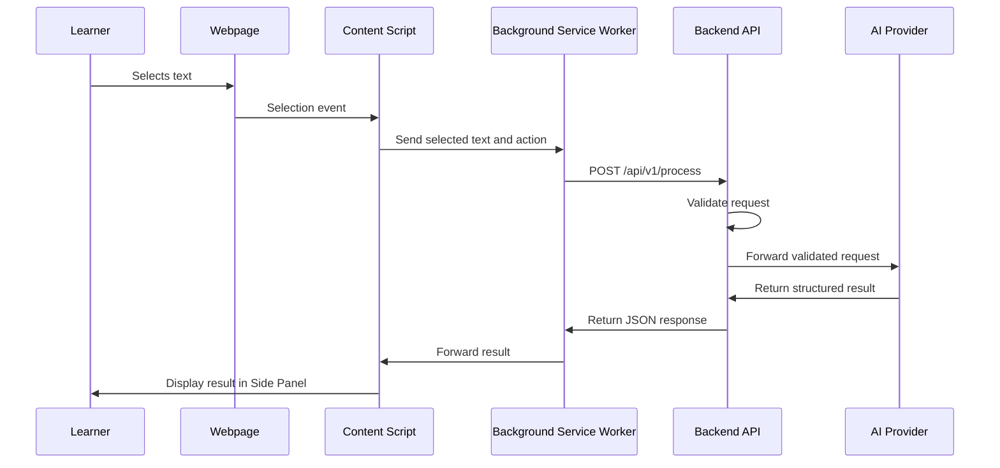
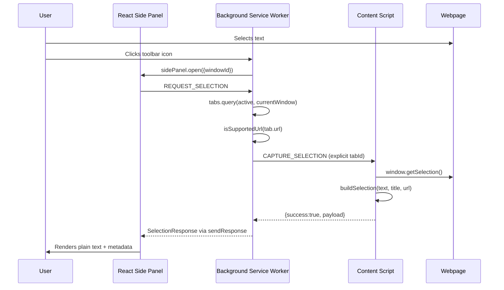

# StudyLens Technical Architecture

## 1. System Overview

StudyLens uses a modular monorepo structure with three main components:

1. **Chrome Extension (Manifest V3):** Handles UI, page interaction, and messaging.
2. **Backend (Node.js + Express):** Handles request validation, AI orchestration, and security.
3. **Shared Contracts:** Defines typed APIs and runtime validation for communication.

## 2. Component Responsibilities

| Component | Technology | Responsibility |
|---|---|---|
| Extension UI | React + TypeScript | Side Panel interface, loading states, result display |
| Content Script | TypeScript | Detects text selection and extracts webpage content |
| Background Service Worker | TypeScript | Routes messages between content script and backend |
| Backend API | Node.js + Express | Validates requests and manages AI processing |
| AI Adapter | TypeScript | Abstracts AI provider details behind a common interface |
| Shared Contracts | TypeScript | Maintains request/response types and runtime validation |

## 3. Data Flow



## 4. Current Implementation Boundary

Implemented in Phase 0:

- Shared TypeScript request and response contracts.
- Shared runtime request validation.
- Express backend health endpoint.
- Express processing endpoint with validation.
- Request ID handling.
- Metadata-only request logging.
- Development environment configuration.

Not implemented yet:

- Chrome Manifest V3 configuration.
- Side Panel UI.
- Content Script.
- Background Service Worker.
- AI provider integration.
- Database or request history.
- Speech and reading-view functionality.

## 5. Repository Structure

```text
studylens/
├── docs/
│   ├── decisions/
│   ├── product-requirements.md
│   ├── architecture.md
│   ├── api-contract.md
│   ├── privacy-security.md
│   ├── setup-and-demo.md
│   └── phase-0-completion-report.md
├── extension/
│   └── scripts/
├── backend/
│   └── src/
│       └── server.ts
├── shared/
│   └── src/
│       ├── contracts/
│       └── tests/
├── .env.example
├── .gitignore
├── package.json
└── tsconfig.base.json
```

## 6. Privacy and Security

- Only the text required for the requested action should be transmitted.
- Raw webpage text must not be stored by default.
- API keys must remain on the backend.
- Webpage content must be treated as untrusted input.
- AI-generated scripts and HTML must never be executed directly.
- Request logs must contain metadata only, never submitted text or model output.
- Chrome permissions must be limited to the actual extension requirements.

## Implemented extension components (Phase 1)

| File | Responsibility |
| --- | --- |
| `extension/public/manifest.json` | MV3 config: action, side panel, background worker, content-script matches, permissions |
| `extension/src/background/service-worker.ts` | Resolves the active tab, checks URL support, routes capture requests, opens the side panel |
| `extension/src/content/selection.ts` | Thin browser wrapper: reads `window.getSelection()`, answers `CAPTURE_SELECTION` |
| `extension/src/content/capture.ts` | Pure logic: trim, 5000-char truncation, `SourceInfo` construction. No browser globals. |
| `extension/src/types/messages.ts` | Message constants, payload types, runtime type guards, URL support check |
| `extension/src/sidepanel/App.tsx` | React UI: idle / loading / empty / error / ready states, plain-text rendering |

### Actual message flow



### Build architecture

Two independent Vite passes, because Chrome runs content scripts as **classic scripts** but requires the service worker to be an **ES module**:

| Pass | Config | Input | Format | Output |
| --- | --- | --- | --- | --- |
| App | `vite.config.ts` | side panel HTML + background TS | ESM | `sidepanel.js`, `background.js`, assets, copies `manifest.json` |
| Content | `vite.content.config.ts` | `selection.ts` only | IIFE | self-contained `content.js`, no imports |

The content pass sets `emptyOutDir: false` and `copyPublicDir: false` so it does not erase the app output.

### Not implemented yet
Extension → backend HTTP calls, AI provider adapter, speech, translation, steps, reading view, persistence.